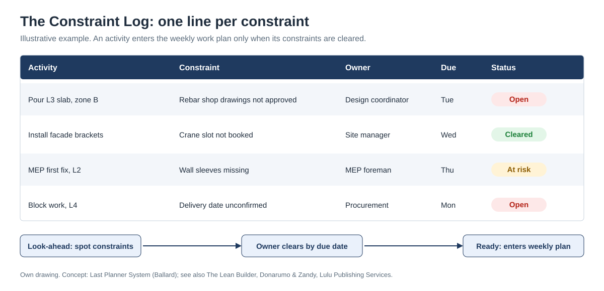

Most weekly plans do not fail because crews are slow. They fail because the work was never ready to start. The drawing was not approved, the crane was not booked, the sleeves were missing. Everyone discovers it on the morning the crew arrives.

The Last Planner System (LPS), developed by Glenn Ballard and Greg Howell and promoted by the Lean Construction Institute, deals with this with a very plain tool: the **constraint log**.

## What is a constraint?

A constraint is anything that must be in place before an activity can start and finish as planned. Common groups are:

- **Information:** approved drawings, answered RFIs, specifications
- **Materials:** delivery dates, approvals, storage
- **Equipment:** cranes, hoists, scaffolding
- **Labor:** the right crew, with the right skills, available that week
- **Prerequisite work:** a preceding trade has finished and the area is handed over
- **Permits and space:** inspections, access, work-area conflicts

## The log itself

The log is a table with one line per constraint. A basic version needs five columns: the activity, the constraint, the owner, the due date and the status.

*Figure 1. An illustrative constraint log. The rows are examples, not data from a real project. Own drawing.*

Two details make the difference between a useful log and a list nobody reads:

1. **Write the constraint precisely.** "Drawings" is a topic. "Rebar shop drawings for the L3 slab not approved" is a constraint someone can act on.
2. **Give every line one named owner and a due date.** A constraint owned by "the team" is owned by nobody.

## Reading the status column

| Status | Meaning | What it triggers |
| --- | --- | --- |
| **Open** | The constraint is not resolved. | The activity is not ready. It stays out of the weekly plan. |
| **At risk** | Not resolved yet, and the due date is close or the owner is unsure. | Follow up now, or prepare an alternative. |
| **Cleared** | The constraint is resolved. | When all constraints of an activity are cleared, the activity is ready. |

These three labels are a simple convention used in this article. LPS does not prescribe a fixed set. Some teams use only open and closed, others add colors or dates. Pick one set and keep it consistent.

## How the log feeds the weekly plan

The log connects two LPS steps:

1. **Look-ahead planning.** Looking several weeks ahead, the team lists what each upcoming activity needs and writes down every constraint it finds.
2. **Making work ready.** Owners work to clear their constraints before the activity's week arrives. This is the heart of make-ready.

Then, in the weekly planning meeting, one rule applies: **only activities with no open constraint enter the weekly work plan.** Crews commit to work that can actually be done. That is why this small habit supports a higher PPC (Percent Plan Complete), the share of planned tasks that were completed as planned. When a task is missed, the reason can be traced back to a constraint that was or was not on the log.

## Common mistakes

- **A log kept by one planner alone.** Constraints are found in the field and in design and procurement offices. The whole team has to feed it.
- **Vague entries and no owner.** See above.
- **Logging but never reviewing.** The log has to be read in every weekly meeting, not only filled in.
- **Hiding "at risk".** If something is slipping, mark it at risk early, while there is still time to react.
- **Treating the log as a blame list.** Its purpose is to remove obstacles, not to find who is guilty.

## How to start this week

1. Take next week's planned activities.
2. For each one, ask: what has to be true before the crew starts?
3. Write each answer as one line with an owner and a due date.
4. Review the log for 10 minutes in your next planning meeting, and plan only the activities that are ready.

A spreadsheet is enough. The value is in the conversation the table forces, not in the software.

## Sources

- Ballard, G. and Howell, G., work on the Last Planner System, and the Lean Construction Institute.
- Donarumo, D. and Zandy, J., *The Lean Builder*, Lulu Publishing Services, 2019. This article rewrites ideas in my own words; the figure and examples are my own.

