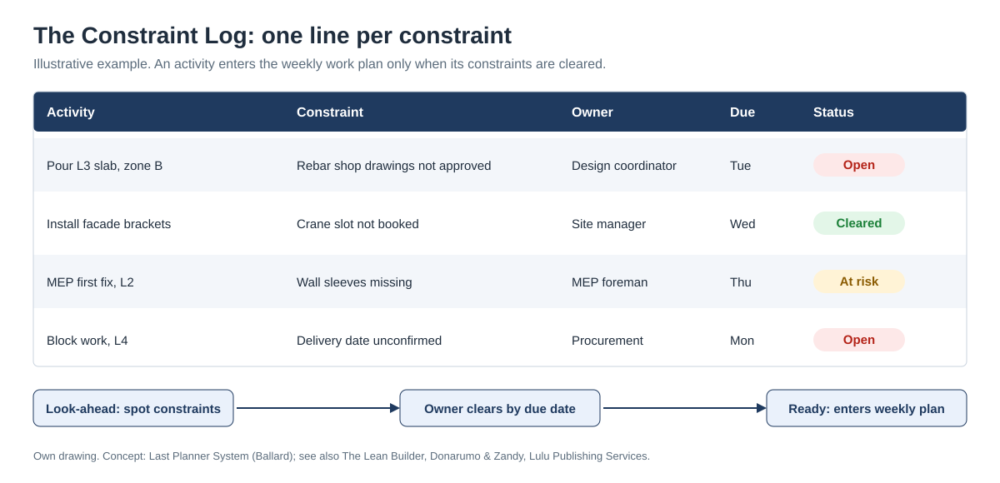

بیشتر برنامه‌های هفتگی به این دلیل شکست نمی‌خورند که گروه‌ها کند کار می‌کنند. شکست می‌خورند چون کار از اول آماده‌ی شروع نبوده است. نقشه تأیید نشده، جرثقیل رزرو نشده یا غلاف‌ها (sleeves) در دیوار نیست، و همه صبح روزی که گروه سر کار می‌رسد این را می‌فهمند.

سیستم Last Planner (به اختصار LPS)، که گلن بالارد و گرگ هاول توسعه داده‌اند و مؤسسه‌ی Lean Construction Institute آن را ترویج می‌کند، برای این مشکل ابزاری بسیار ساده دارد: **لاگ محدودیت‌ها (constraint log)**.

## محدودیت (constraint) چیست؟

محدودیت هر چیزی است که باید پیش از شروع یک فعالیت در جای خود باشد تا آن فعالیت طبق برنامه شروع و تمام شود. گروه‌های رایج:

- **اطلاعات:** نقشه‌های تأییدشده، پاسخ RFIها، مشخصات فنی
- **مصالح:** تاریخ تحویل، تأییدیه‌ها، انبار
- **تجهیزات:** جرثقیل، بالابر، داربست
- **نیروی کار:** گروه مناسب با مهارت مناسب در همان هفته
- **کار پیش‌نیاز:** پیمانکار قبلی کارش را تمام کرده و محل تحویل شده است
- **مجوز و فضا:** بازرسی، دسترسی، تداخل محل کار

## خود لاگ

لاگ جدولی است با یک سطر برای هر محدودیت. نسخه‌ی پایه پنج ستون دارد: فعالیت، محدودیت، مسئول، موعد و وضعیت.

*شکل ۱. نمونه‌ی توضیحی از لاگ محدودیت. سطرها مثال هستند و داده‌ی پروژه‌ی واقعی نیستند. طراحی از نگارنده.*

دو نکته فرق لاگ مفید با فهرستی را که کسی نمی‌خواند می‌سازد:

۱. **محدودیت را دقیق بنویس.** «نقشه» یک موضوع است. «نقشه‌های کارگاهی آرماتور دال طبقه‌ی سوم تأیید نشده» محدودیتی است که کسی می‌تواند رویش کار کند.
۲. **برای هر سطر یک مسئول مشخص و یک موعد بگذار.** محدودیتی که مسئولش «تیم» است، مسئول ندارد.

## ستون وضعیت را چطور بخوانیم

| وضعیت | معنی | چه اقدامی را به دنبال دارد |
| --- | --- | --- |
| **Open (باز)** | محدودیت هنوز برطرف نشده. | فعالیت آماده نیست و وارد برنامه‌ی هفتگی نمی‌شود. |
| **At risk (در خطر)** | هنوز برطرف نشده و موعد نزدیک است یا مسئول مطمئن نیست. | همین حالا پیگیری کن یا برنامه‌ی جایگزین بچین. |
| **Cleared (برطرف‌شده)** | محدودیت حل شده. | وقتی همه‌ی محدودیت‌های یک فعالیت برطرف شد، فعالیت آماده است. |

این سه برچسب قراردادی ساده در همین مقاله است و LPS مجموعه‌ی ثابتی برای آن تعیین نکرده. بعضی تیم‌ها فقط «باز/بسته» می‌نویسند و بعضی رنگ یا تاریخ اضافه می‌کنند. یک مجموعه انتخاب کن و ثابت نگه دار.

## لاگ چطور به برنامه‌ی هفتگی وصل می‌شود

لاگ دو گام LPS را به هم وصل می‌کند:

۱. **برنامه‌ریزی نگاه‌به‌جلو (look-ahead).** تیم چند هفته‌ی آینده را نگاه می‌کند، می‌نویسد هر فعالیت چه چیزهایی لازم دارد و هر محدودیتی را که می‌بیند ثبت می‌کند.
۲. **آماده‌سازی کار (make-ready).** مسئول‌ها پیش از رسیدن هفته‌ی اجرای فعالیت، محدودیت‌هایشان را برطرف می‌کنند. این هسته‌ی make-ready است.

سپس در جلسه‌ی برنامه‌ریزی هفتگی یک قاعده حاکم است: **فقط فعالیتی که هیچ محدودیت بازی ندارد وارد برنامه‌ی کاری هفتگی می‌شود.** گروه‌ها فقط کاری را تعهد می‌کنند که واقعاً شدنی است. به همین دلیل این عادت کوچک از PPC (درصد برنامه‌ی انجام‌شده) بالاتر پشتیبانی می‌کند؛ PPC سهم کارهای برنامه‌ریزی‌شده‌ای است که همان‌طور که برنامه‌ریزی شده بود تمام شدند. وقتی کاری انجام نشد، دلیلش را می‌شود به محدودیتی برگرداند که در لاگ بوده یا نبوده است.

## خطاهای رایج

- **لاگی که فقط یک برنامه‌ریز پر می‌کند.** محدودیت‌ها در کارگاه و دفاتر طراحی و تدارکات پیدا می‌شوند. کل تیم باید لاگ را تغذیه کند.
- **ثبت مبهم و بدون مسئول.** توضیحش بالا آمد.
- **ثبت بدون مرور.** لاگ باید در هر جلسه‌ی هفتگی خوانده شود، نه فقط پر شود.
- **پنهان کردن «در خطر».** اگر چیزی دارد عقب می‌افتد، زود علامتش بزن تا هنوز وقت واکنش باشد.
- **تبدیل لاگ به فهرست مقصرها.** هدفش برداشتن مانع است، نه پیدا کردن مقصر.

## از این هفته چطور شروع کنیم

۱. فعالیت‌های برنامه‌ریزی‌شده‌ی هفته‌ی بعد را بردار.
۲. برای هرکدام بپرس: پیش از شروع گروه چه چیزی باید درست باشد؟
۳. هر پاسخ را یک سطر با مسئول و موعد بنویس.
۴. در جلسه‌ی بعد ۱۰ دقیقه لاگ را مرور کن و فقط فعالیت‌های آماده را برنامه‌ریزی کن.

یک صفحه‌گسترده (spreadsheet) کافی است. ارزش کار در گفتگویی است که این جدول ایجاد می‌کند، نه در نرم‌افزار.

## منابع

- Ballard, G. and Howell, G.، کارهای مربوط به Last Planner System، و Lean Construction Institute.
- Donarumo, D. and Zandy, J., *The Lean Builder*, Lulu Publishing Services, 2019. این مقاله ایده‌ها را با زبان خود نگارنده بازنویسی کرده است؛ شکل و مثال‌ها از خود اوست.

